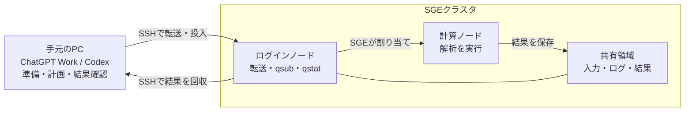
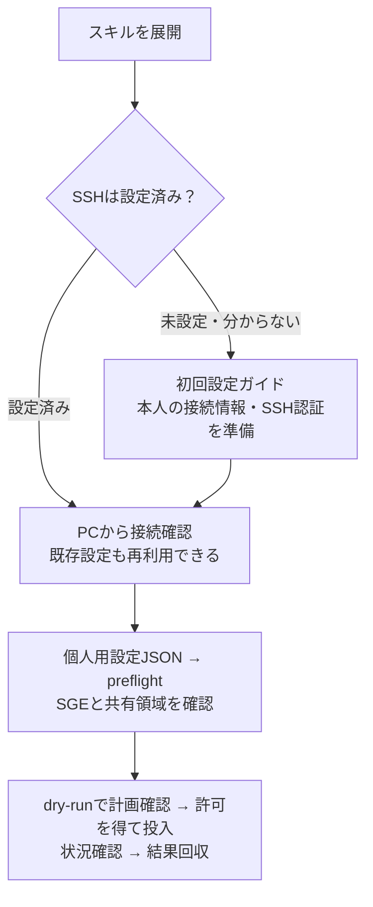

# SGE HPC

**手元のChatGPT Work / Codexで解析を準備し、重い処理をSGEクラスタへ送るスキルです。**

AIはPC上でコードの作成・修正、実行計画、結果の確認を担当します。必要なファイルをSSHで転送し、解析コマンドを `qsub` で計算ノードへ投入します。クラスタにChatGPTやCodexをインストールする必要はありません。



| 構成 | AIが使う実行環境 | 解析の実行 |
|---|---|---|
| **このスキルの基本構成** | 手元のPC | PCからSSHでジョブを投入し、SGE計算ノードで実行 |
| SSH先でCodexを動かす構成 | リモートサーバー | リモートのCodexから実行・ジョブ投入 |

ここで「PCで動く」とは、AIが操作するファイル・Python・SSHの実行環境が手元にある、という意味です。モデルの推論をPCで行うという意味ではありません。ログインノードでは重い解析を直接実行しません。

[はじめる](#はじめる) · [SSH初回設定](references/setup.md) · [ジョブ実行](references/jobs.md) · [困ったとき](references/troubleshooting.md) · [ライセンス](LICENSE)

## できることと必要な環境

- SSH接続確認、コード・小さな入力の転送
- SGEジョブの投入計画、投入、状況確認
- ログと最終結果の回収
- SSH未設定の人への対話による導入案内

| 場所 | 必要なもの |
|---|---|
| 手元のPC | Python 3.12以上、OpenSSHクライアント、本人のSSH認証、HPCへ届くネットワーク／必要ならVPN |
| クラスタ | SGE（Grid Engine）、POSIXシェル、`tar`、全計算ノードから見える書き込み可能な共有領域 |
| AIと一緒に使う場合 | 手元のファイルとターミナルを操作できるChatGPT Work / Codexの実行環境 |

追加のPythonパッケージ、ローカルのBash・WSL・rsyncは不要です。Slurm向けではありません。JupyterHubにログインできることと、PCからSSHでジョブを投入できることは別です。MFA等で非対話SSHが認められない環境では、施設が認める接続方法を管理者と確認してください。

## はじめる

ZIPを展開し、`SKILL.md` と `scripts/` が同じフォルダ内にあることを確認します。今後GitHubの「Download ZIP」を使う場合も、この2つが見えるフォルダが起点です。



**SSHが初めてなら、[初回設定ガイド](references/setup.md)を順番に進めてください。** OS別の準備、鍵の作成・登録、初回接続、設定JSONの記入まで説明しています。設定済みなら同ガイドの「既存の接続設定」から進めます。

AIに案内してもらう場合は、次の依頼と `sge-hpc` フォルダの場所を渡します。

> このフォルダのSKILL.mdを読み、sge-hpcの初回設定を手伝ってください。普段はJupyterを使っていて、SSHの設定状況は分かりません。まずPCで確認できる項目を調べ、不足している接続情報を教えてください。

接続設定済みなら：

> sge-hpcで、この個人用設定JSONを使って接続確認をしてください。ジョブはまだ投入しないでください。

## ChatGPT Work / Codexへ登録

### Codex

フォルダ全体を次のいずれかへ置きます。GitHub等から入手したフォルダ名に接尾辞がある場合は、配置先で `sge-hpc` に揃えます。フォルダが二重にならないようにしてください。

| 利用範囲 | 配置先 |
|---|---|
| 本人の各プロジェクトで使う | `~/.agents/skills/sge-hpc/SKILL.md` |
| 特定のプロジェクトだけで使う | `<プロジェクト>/.agents/skills/sge-hpc/SKILL.md` |

Windowsの `~` は通常、エクスプローラーの `%USERPROFILE%` に相当します。登録後は `$sge-hpc` で呼び出せます。認識されない場合はCodexを再起動します。[公式の配置先・呼び出し方法](https://learn.chatgpt.com/docs/build-skills)も参照してください。

### ChatGPT Work（デスクトップ）

フォルダをPCに置き、Workから読めるようにします。利用中のアプリにスキルの取り込み機能があれば、その案内に従ってフォルダ一式を登録します。登録できた場合は、候補からスキルを選んで呼び出せます。

取り込み方法が分からない場合も、上記の依頼文とフォルダの場所を渡し、`SKILL.md` を明示的に読ませて利用できます。これは自動検出への登録とは別です。Workでの登録・実行手順は利用者環境での確認が必要です。

**実際にPython・SSHを動かす場所を確認してください。** クラウド環境にファイルを添付するだけでは、手元の鍵や学内ネットワークへアクセスできません。実行環境が異なるときは、AIにコマンドを準備してもらい、PCの端末で実行できます。

## まず手元の環境を確認

スキルフォルダでターミナルを開きます。Windowsではエクスプローラーでフォルダを右クリックして「ターミナルで開く」、macOS / Linuxでは端末でそのフォルダへ移動してください。

Windows（PowerShell）：

```powershell
python --version
python scripts/sge_hpc.py doctor
```

macOS / Linux：

```bash
python3 --version
python3 scripts/sge_hpc.py doctor
```

`doctor` は設定ファイルなしでPythonの版とSSH関連コマンドの有無を確認します。ネットワーク接続、鍵の読み取り、設定変更は行いません。Pythonが見つからない・3.12未満の場合は[初回設定ガイド](references/setup.md)へ進みます。

その後、個人用設定JSONをスキルの外に作り、`preflight` でクラスタを確認します。コマンドと期待される結果は初回設定ガイドにあります。

## 日常の使い方

> この解析をHPCで実行する計画を作って。入力と出力先、必要なCPU・メモリを示して、まずdry-runして。

> ジョブ番号12345の状態を確認して。

> 今回の実行のログと最終結果をPCへ回収して、成功したか確認して。

投入前に計画を確認し、許可を得てから実行します。実行ごとに作業ディレクトリを分け、生データや大きな中間物はクラスタに残します。AIを使わず操作する手順も[ジョブ実行ガイド](references/jobs.md)にあります。

## 資料と動作確認

| 資料 | 内容 |
|---|---|
| [SKILL.md](SKILL.md) | AIが読む手順と操作範囲 |
| [初回設定](references/setup.md) | Jupyter利用者向けの確認、OS別準備、SSH認証、設定JSON |
| [ジョブ実行](references/jobs.md) | 小規模の確認ジョブから転送・投入・回収まで |
| [トラブル対処](references/troubleshooting.md) | SSH・SGE・転送のエラーと相談先 |
| [ライセンス](LICENSE) | コード・スキル本文・付属文書にMITを適用 |
| [公開前の利用確認](references/validation.md) | 実クラスタと初めて使う人による確認項目 |

ローカル自動試験は `python -m unittest discover -s tests -v` で実行できます（macOS / Linuxでは `python3`）。SSH・SGEの応答を模擬した試験で、実クラスタでの接続・投入・計算と、各OSの初回導入は未検証です。READMEのMermaid図はGitHubで表示する構成です。

個人設定、秘密鍵、実データはスキルフォルダに置かないでください。`.gitignore` は誤登録を減らす補助で、機密情報の検出を保証しません。現在は公開準備中です。

## ライセンス

コード・スキル本文・付属文書を [MIT License](LICENSE) で提供します。改変・再配布・商用利用が可能です。著作権表示と許諾表示を維持してください。HPC上で使う解析ソフト・データ・サーバーの利用条件は、それぞれ別に従います。[採用理由](references/licensing.md)も参照できます。
